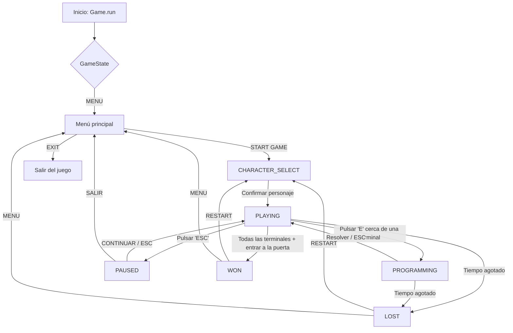

# Documentación del Flujo Completo: Code Escape - Factory Reset

Este documento describe la máquina de estados, la navegación y las reglas de negocio del juego, desde el inicio hasta las condiciones de victoria o derrota.

## 1. Arquitectura de estados

`Game` (`src/engine.py`) es el loop principal y el router de escenas. El enum `GameState` (`src/game_state.py`) define los estados y `src/scenes/` tiene una instancia de escena por estado. Cada escena implementa `handle_event`, `update(dt)` y `draw`; la lógica de cada estado vive en su escena, no en `Game`.

| Estado (`GameState`) | Escena | Responsabilidad |
| --- | --- | --- |
| `MENU` | `MenuScene` | Menú principal |
| `CHARACTER_SELECT` | `CharacterSelectScene` | Elección de operario |
| `PLAYING` | `PlayingScene` | Exploración, colisiones y cronómetro |
| `PROGRAMMING` | `ProgrammingScene` | Puzzle de la terminal activa |
| `PAUSED` | `PausedScene` | Pausa y reanudación |
| `WON` / `LOST` | `GameOverScene` | Resultado y reinicio |

## 2. Diagrama de Flujo Lógico

---

## 3. Descripción Detallada de los Estados

### 3.1 Menú Principal (`MENU`)
Es el punto de entrada. Permite iniciar la aventura o salir de la aplicación.
*   **Controles**: Mouse (clic/hover) o teclado (flechas + `Enter`).
*   **Opciones**: `START GAME` y `EXIT`.
*   **Punto Importante**: El cronómetro no corre en este estado.

### 3.2 Selección de Personaje (`CHARACTER_SELECT`)
Fase previa a la acción donde el jugador elige su identidad.
*   **Personajes Disponibles**: Obrero, Jefe y Bombero.
*   **Controles**: Flechas izquierda/derecha + `Enter`, o mouse.
*   **Punto Importante**: Al confirmar, se cargan los sprites del personaje elegido (frente, espalda y perfil) y recién ahí arranca el cronómetro (`inicio_ticks`).

### 3.3 Fase de Exploración (`PLAYING`)
Es el núcleo del juego. El jugador se desplaza por la fábrica.
*   **Movimiento**: Flechas o `WASD`, con delta time y colisiones contra muros y objetos sólidos.
*   **Tiempo Límite**: Determinado por `TIEMPO_LIMITE` en `settings.py` (60 segundos). Empieza a descontar al confirmar el personaje.
*   **Misiones**: Localizar las 4 terminales industriales repartidas por el mapa. El HUD muestra el tiempo restante y el progreso con el formato `Misiones: 0/4`.
*   **Pausa**: `ESC` abre el menú de pausa y congela el cronómetro.
*   **Puerta**: Permanece bloqueada hasta resolver las 4 terminales.

### 3.4 Fase de Programación / Puzzles (`PROGRAMMING`)
Se activa al interactuar con una terminal (`E`).
*   **Objetivo**: Escribir una única sentencia de asignación de Python (`nombre = literal`) que coincida con el desafío.
*   **Validación**: `PythonAssignmentValidator` (`src/puzzle_validators.py`) parsea la respuesta con `ast`; tolera espacios, comentarios y comillas simples o dobles, y rechaza expresiones, sentencias extra y confusión entre `bool` e `int`.
*   **Ayuda**: `H` muestra u oculta la pista. `Enter` valida; un error muestra el mensaje y la pista, y reproduce el sonido de error.
*   **Salida**: `ESC` vuelve a la exploración, se haya resuelto o no.
*   **Punto Importante**: El cronómetro sigue corriendo durante la programación; si llega a cero, se pasa a `LOST`.
*   **Consecuencia**: Al resolver una terminal se marca como resuelta. Cuando las 4 están resueltas, la puerta de salida se abre visualmente y permite el paso.

### 3.5 Menú de Pausa (`PAUSED`)
Permite detener la acción desde la exploración mediante `ESC`.
*   **Gestión de Tiempo**: Al pausar se guarda el instante exacto; al reanudar, `inicio_ticks` se corre por el tiempo pausado para no penalizar al jugador.
*   **Opciones**: `CONTINUAR` (o `ESC`) reanuda; `SALIR` reinicia la partida y vuelve al menú principal.
*   **Audio**: La música de ambiente se pausa y se reanuda con la partida.

### 3.6 Pantalla de Resultados (`WON` / `LOST`)
Muestra el mensaje de éxito o fracaso.
*   **Estado Perdido**: "PERDISTE" / "Te has quedado encerrado en la fabrica."
*   **Estado Ganado**: "¡GANASTE!" / "Has escapado de la fabrica a tiempo."
*   **Opciones**: `RESTART` reinicia y vuelve a la selección de personaje; `MENU` reinicia y vuelve al menú principal. Se navega con `←`/`→` + `Enter` o con mouse.

---

## 4. Puntos Críticos y Reglas de Negocio

1.  **Sincronización de Audio**:
    *   La música de ambiente suena en loop (`ambiente.mp3`).
    *   Hay alarmas automáticas cuando restan 10 y 5 segundos (`alarma3.mp3`).
    *   Hay sonidos específicos para error (`error.mp3`), victoria (`ganaste.mp3`) y derrota (`perdiste.mp3`).
    *   La música se pausa durante los sonidos de victoria o derrota y se reanuda cuando terminan. El código no crea hilos: `pygame.mixer` reproduce la música y los efectos de forma asíncrona.

2.  **Sistema de Colisiones**:
    *   El `MapLoader` (`src/map_loader.py`) lee el layout desde `src/assets/maps/factory.json` (capas `floor` y `objects`, más una leyenda por símbolo) y deriva los muros y objetos sólidos (escritorios, tanques industriales, buzones, etc.) con los que el jugador no puede atravesar. El `MapRenderer` solo dibuja esas capas.
    *   El jugador mueve una posición flotante y subdivide el paso para que un frame largo no atraviese una pared.
    *   La puerta es un objeto sólido infranqueable hasta que se completan todas las misiones. Al abrirse, entrar en ella dispara `WON`.

3.  **UI Dinámica**:
    *   La interfaz muestra en tiempo real el "Tiempo restante" y el progreso de las "Misiones".
    *   El título del juego en el menú principal tiene un efecto visual curvo y animaciones de obreros trabajando de fondo.

4.  **Reseteo de Estado**:
    *   Al reiniciar (`reset_game`), se recrean las terminales, se resetean el cronómetro y las banderas de audio, se vuelve a posicionar al jugador en el spawn inicial y se limpia la selección de personaje.

---

## 5. Resumen de Controles

| Acción | Entrada |
| --- | --- |
| Mover al jugador | Flechas o `WASD` |
| Interactuar con una terminal | `E` |
| Confirmar en menús | `Enter` o clic |
| Mostrar/ocultar pista | `H` (en programación) |
| Cerrar la terminal | `Esc` |
| Pausar / reanudar | `Esc` |
| Navegar la pantalla final | `←`/`→` + `Enter` o clic |
| Salir del juego | Opción `EXIT` del menú |
